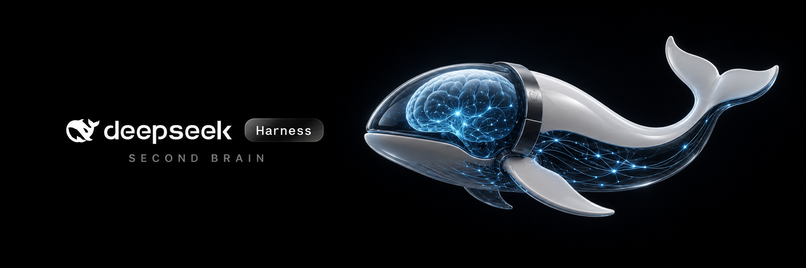

# DeepSeek Harness Brain

<p align="center">
  
</p>

<p align="center">
  <a href="https://github.com/AgriciDaniel/deepseek-harness-brain/actions/workflows/ci.yml"></a>
  <a href="LICENSE"></a>
  <a href="https://github.com/AgriciDaniel/deepseek-harness-brain/releases/tag/v0.2.0"></a>
  
</p>

DeepSeek Harness Brain 0.2.0 is an independent, evidence-gated Obsidian knowledge
base for understanding, reviewing, extending, and selectively porting ideas from
[DeepSeek Harness](https://github.com/deepseek-ai/deepseek-harness). This
community release was validated against a pinned upstream snapshot with
deterministic importer, vault, pipeline, and packaging checks.

Browser, live-provider, native, cross-platform, comprehensive security-audit,
and production-scale behavior remain outside the verified release evidence.
This project is not affiliated with or endorsed by DeepSeek.

## Outputs

- A plain-language map of how the harness fits together.
- Source-cited notes about sessions, tools, permissions, persistence, plugins,
  Cordis, subagents, prompts, providers, and verification.
- A portability matrix that separates reusable patterns from framework-specific
  machinery.
- A deterministic sample vault and an allowlisted checkout importer.
- A grounded secretary and four curator agents for evidence-based review.
- Explicit confidence labels, open risks, and verification limits.

## Start here

- Plain-English guide: [PDF](docs/DeepSeek-Harness-Plain-English-Guide.pdf) or [HTML](docs/DEEPSEEK_HARNESS_PLAIN_ENGLISH_GUIDE.html)
- [Five-minute operator kit](docs/OPERATOR_KIT.md)
- [Product boundaries](docs/PRODUCT_BOUNDARIES.md)
- [Sample Obsidian vault](examples/sample-vault)
- [Portability Matrix](assets/template-brain/wiki/deliverables/Portability%20Matrix.md)
- [Cordis Fork Delta](assets/template-brain/wiki/concepts/Cordis%20Fork%20Delta.md)
- [Known limitations and open risks](assets/template-brain/wiki/gaps/Known%20Limitations%20and%20Open%20Risks.md)
- [Verification ledger](references/verification-ledger.json)

## How it works

<p align="center">
  
</p>

Evidence enters through pinned, content-addressed source capture. Curated rules
turn that evidence into linked notes, ledgers, portability guidance, and reports.
Deterministic checks prevent prose alone from claiming a stronger maturity tier.

## Who this is for

- Developers evaluating DeepSeek Harness architecture.
- Teams deciding which harness patterns to port into existing applications.
- Operators who want an evidence trail instead of unsourced summaries.
- Contributors checking claims, tests, lifecycle behavior, or security boundaries.

## Quick start

Requires Python 3.11 or newer.

```bash
python -m pip install -e .
deepseek-harness-brain demo
deepseek-harness-brain lint --vault examples/sample-vault
deepseek-harness-brain report --vault examples/sample-vault --html-only
```

To compare a local DeepSeek Harness checkout against the reviewed evidence:

```bash
deepseek-harness-brain import-checkout \
  --checkout /path/to/deepseek-harness \
  --vault examples/sample-vault \
  --expected-commit b150a551b8d465e31e418e1b2eaf5e79bbb7d28e \
  --as-of 2026-08-21
```

To create a separate client vault:

```bash
deepseek-harness-brain new acme \
  --client-name "Acme Co" \
  --owner "Your Name" \
  --out-dir ~/deepseek-harness-brain-vaults

deepseek-harness-brain ingest \
  --vault ~/deepseek-harness-brain-vaults/acme \
  --file tests/fixtures/sample-source.md

deepseek-harness-brain synthesize \
  --vault ~/deepseek-harness-brain-vaults/acme
```

## What to port first

The strongest framework-neutral candidates are:

1. Append-only session events and reconstructable model requests.
2. One guarded tool executor with typed approval and cancellation.
3. Capability seams that separate definition, provider, and consumer.
4. Deterministic prompt and tool-schema assembly.
5. A small durable persistence contract before a complex backend.

Profiles, hot reload, model-authored workflows, generated RPC, and the full
Cordis runtime are useful only when a product has the matching complexity.
See the [Portability Matrix](assets/template-brain/wiki/deliverables/Portability%20Matrix.md)
for the evidence and tradeoffs.

## Evidence boundaries

This project is advisory and read-only by default. It does not mutate accounts,
production systems, customer records, or live deployments. A passing static,
unit, build, or keyless check is never presented as browser, native, live-provider,
security-audit, or production evidence.

The included raw captures are an allowlisted set of public files from the
MIT-licensed upstream repository. Client or private source captures must never
be committed. See [Publishing Notice](PUBLISHING_NOTICE.md),
[Third-Party Notices](THIRD_PARTY_NOTICES.md), and
[Security Policy](SECURITY.md).

## Verification

```bash
python tests/test_harness_adapter.py
python tests/test_pipeline.py
python scripts/audit_brain.py --json --report-only
```

The v0.2.0 community release passed the local release audit and packaging gate.
The [release status](references/release-status.json) records exactly what was
verified and which runtime tiers remain outside the evidence. Brainstein's
generic anatomy score remains useful structural feedback, but it does not
override the explicit release-status guard.

## Community

- Read [Contributing](CONTRIBUTING.md) before changing code, evidence, or vault notes.
- Use [Support](SUPPORT.md) for help and the issue forms for reproducible bugs or evidence corrections.
- Report sensitive findings through the private route in [Security](SECURITY.md).
- Review [Code of Conduct](CODE_OF_CONDUCT.md) before participating.

## Visual identity

The main cover was supplied by the project owner and optimized without
overwriting the source file. Supporting artwork was generated specifically for
this repository. No visual was copied from the official website. DeepSeek marks
on the cover identify the subject of the research and do not imply affiliation
or endorsement. See [asset provenance](assets/images/README.md).

## License and attribution

DeepSeek Harness Brain is available under the [MIT License](LICENSE).
Selected upstream DeepSeek Harness files remain copyright DeepSeek and
contributors under their MIT license. Full attribution and the reviewed commit
are recorded in [Third-Party Notices](THIRD_PARTY_NOTICES.md) and
[the upstream license copy](licenses/DEEPSEEK-HARNESS-MIT.txt).
