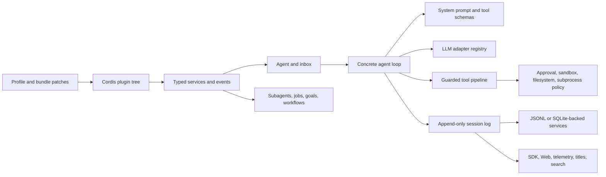

# DeepSeek Harness System Dissection

DeepSeek Harness is best understood as a Cordis plugin operating system for agents, not as one monolithic loop. The concrete loop is deliberately narrow. Composition, models, tools, policy, persistence, subagents, workflows, settings, credentials, transport, and UI are separate plugins connected through typed services and events.

## Evidence Snapshot

- Reviewed upstream commit: `b150a551b8d465e31e418e1b2eaf5e79bbb7d28e`.
- Package version: `0.1.1-rc.2`.
- Repository state at review: clean immediately after clone.
- Tracked files observed: 7,903.
- Tracked bytes observed: 51,116,248.
- TypeScript and TSX files observed: 2,734.
- Markdown files observed: 2,506.
- Package manifests under `packages/*/*`: 234.
- Workspace projects reported by pnpm: 246.
- Test-like tracked files observed: 1,918.
- Environment used: Linux x64, Node 24.16.0, pnpm 11.7.0.
- Source build result: passed for Host, Client, generated contracts, and Web production assets.

These inventory numbers are local observations of the pinned checkout. They are not promises about another commit. See [[Known Limitations and Open Risks]] for refresh conditions.

## One-System View

The diagram is a synthesis of current repository contracts. The owning generated graph remains the source for exact package edges.

## Composition Plane

A profile is a named composition. It stacks bundles, then a profile-specific `cordis.patch.yml`, then the Harness-home patch, then an invocation overlay. A bundle is a distributable patch layer. Rows have stable ids so later layers can replace or insert plugin entries.

`dsh-base` supplies the shared service and policy foundation. `dsh-web-app` adds the HTTP host, browser transport, and client plugin roster. `dsh-headless` adds a direct one-shot runner without a Web server. This makes deployment mode a composition choice instead of a fork of the core agent.

Patch replacement is whole-config replacement for the targeted row, not an implicit deep merge. An overlay author must restate every config key that row still needs. This is a powerful mechanism and a common source of accidental omissions. See [[Profile, bundle, and patch-layer configuration]].

## Cordis Runtime Model

Everything important is mounted as a plugin. Plugins contribute services, typed events, and reversible effects to a shared Context. A registration returns or participates in a disposer. Unloading the owning plugin must unwind the contribution.

There is no privileged application core that every feature must edit. The architectural preference is to mount a sibling plugin on a documented extension point. The `agent-loop` package is the concrete loop driver, but hooks, retries, compaction, policy, persistence, UI, telemetry, skills, subagents, goals, and workflow behavior remain outside it.

This yields strong replaceability, but it moves complexity into ownership, scope, load resolution, and teardown. A local change is incomplete until its provider, consumers, disposal behavior, and assembled composition are all understood. See [[Capability seam design]].

## Core Service Spine

The session service owns the append-only event log and in-memory session registry. The agent service owns live agents, the agent factory, inbox operations, and agent-scoped contexts. The agent-loop service creates and resumes concrete agents and drives turns. The system-prompt service assembles prompt sections, variables, runtime contexts, and tool schemas. The tools service registers tools and owns guarded execution. The LLM service registers adapters and normalizes provider failures.

Other domains join this spine without changing it. Persistence subscribes to session events. UI subscribes to durable session events and live agent events. Compaction intercepts pre-step and request-error extension points. Subagent providers create or drive ordinary agent handles. Sandbox and approval policy intercept tool execution.

## Agent Input Model

The live agent has two pending inbox targets. `next-turn` contains ordinary follow-up prompts. `next-step` contains steering or injected context. Follow-up wakes the driver. Steering wakes the driver and targets the next step. Injection targets the next step but does not wake an idle agent.

Inbox changes publish normalized splice events before the live projection changes. Insertions, removals, claiming, and cancellation use the same durable projection vocabulary. A message id identifies a pending occurrence, not a later answer or turn result.

`whenIdle()` observes whole-agent quiescence. It does not settle a particular follow-up. Several messages may share one running interval, and cancellation or disposal may discard unstarted work. This distinction matters for SDK clients and automation.

## Turn and Step Lifecycle

A step is one model request plus the tools that request invokes. A turn is zero or more steps. A turn begins before its first claimed input and ends when no additional work is owed.

The driver claims pending next-step input plus one queued follow-up at the opening boundary. `agent/pre-step` receives the complete proposed message batch. It can enter that batch, replace it, or reject the step. Rejection closes the durable turn without spending a model step.

For an entered step, the loop appends step and user-message events, assembles prompt text and tool schemas, derives model history from the session log, dispatches the model request, records streamed chunks and the final assistant anchor, executes tools, records results, and closes the step. Tool results or new next-step input may cause another step in the same turn.

Before natural turn closure, `agent/turn-stopping` is a serial terminal checkpoint. Turn and step boundaries are durable events. Most interception events are live control points. See [[Turn and Tool Trace Flow]].

## Durable Session Model

The session log is the authoritative source for what the model saw and what durable observers replay. Model history is derived from the log rather than retained as an independent mutable chat array.

The rule `model-visible implies logged` is load-bearing. A new model-visible input needs a corresponding session event and a deterministic projection into request history. The loop's invariant companion can reconstruct a frozen request from the live session and compare it with the exact request identity recorded by the LLM service.

Successful provider calls append an `assistant/message` anchor, including content-less completions. A canceled stream with visible text may append an interrupted anchor so the next request contains the prefix already shown to the user. Provider failure does not commit assistant content.

Persistence is a plugin that writes from session events. `session/flush` is an explicit observation barrier. Session projections, titles, search, telemetry, and clients read the same durable facts rather than invent parallel state.

## Prompt and Tool-Schema Assembly

The system-prompt service collects ordered prompt sections, dynamic contexts, named variables, and tool schema providers. Global and agent-scoped registrations can coexist. An agent-scoped registration shadows the same global name for that agent.

The default harness identity is fixed. A deployment persona is config-authored. The loop supplies model and working-directory variables. Plugins own their own guidance sections. Tool schemas are assembled with prompt sections because what the model is told it can do must match the effective execution set.

Prompt variable interpolation is strict. Unknown variables, valueless registered variables, or malformed complete groups fail loudly. Explicit tool order may list named tools plus one rest marker. Unlisted tools are sorted lexicographically at the rest position.

Prompt text and schemas repeat on every step. Stable prefix content supports KV-cache reuse, while tool registration, restriction, reordering, persona changes, or runtime-context changes can invalidate reuse.

## LLM Plane

The LLM service is an adapter registry, not a hard-coded DeepSeek call inside the loop. The base bundle mounts both the general LLM service and provider implementations. The shipped default route is `deepseek-official` with a configured DeepSeek model.

Before dispatch, the loop asks the exact adapter registration to prepare the call. This validates adapter-owned fields and materializes defaults under the active turn signal. The prepared call retains the same registration across asynchronous resolution and dispatch, preventing hot reload from mixing one adapter's defaults with another adapter's request.

Provider failures are normalized into terminal finish chunks at the public runtime boundary. Middleware or consumer faults remain thrown. Request-error listeners can choose a retry action using the captured retry policy. Unhandled failure remains authoritative.

## Tool Plane

The model emits tool-call blocks. The loop records `tool/call` before execution. The tools runtime applies pre-execute policy, resolves ask decisions, enforces monotonic guards, runs the execution waterfall and tool body, applies post-execute decisions, normalizes the result, runs definition-owned finalization, publishes immutable result observation, then records the single model-facing `tool/result`.

Exclusive tools form barriers. Parallel-safe tool bodies may overlap within a bounded rolling pool. Policy decisions, finalized durable results, and result context remain in model order. Aborting a turn stops new calls and drains started work.

Code Mode does not bypass this pipeline. Its serialized sub-calls carry a parent token, traverse the same policy and execution path, and turn denials into binding rejections. See [[Tool execution and policy pipeline]].

## Security and Permission Plane

Sandbox, approval, permission presets, filesystem observation, subprocess execution, credential resolution, and Web host trust are separate controls. They reinforce one another, but one should never be described as proving the others.

The base profile defaults to `workspace-write` plus `ask`. `danger-full-access` pairs an unrestricted sandbox mode with `never` approval. A deployment may override the mode through the environment or later patch layers.

Tool policy is enforced in the executor path. Filesystem mutation tools also use filesystem-specific intent events and observation policy. Subprocess consumers use the subprocess service, while sandbox providers wrap execution. Credentials resolve through a dedicated service and are not meant to be embedded in composition files.

The Web profile binds to loopback by default and builds a trusted-host set from the active bind plus explicit configuration. See [[Security and Trust Boundaries]].

## Subagents, Jobs, Goals, and Workflows

Subagents are a capability seam outside the concrete loop. Providers range from fresh in-process child agents to continuable external transports. The base composition includes in-process spawn and fork providers plus control, report, and collection tools.

Jobs own background work and collection. Goals own a same-session objective domain. The worker-thread workflow engine runs model-authored orchestration that fans agent calls through a configured provider. These are separate ownership domains, not modes hidden inside the loop.

The integration risk is lifecycle settlement. A parent must distinguish delegated output, child quiescence, background collection, cancellation, and disposal. One running status does not prove one delegated message completed.

## Persistence and Storage

Session persistence supports JSONL and SQLite implementations behind a service. Session query and projection are separate capabilities. General non-session storage has its own service and backends. Attachments, settings, credentials, spill files, and workspace entities also have distinct ownership.

This separation prevents the session log from becoming an untyped database for everything. It also means backup, migration, and privacy analysis must identify which store owns the data being discussed.

On-disk compatibility is intentionally weak during developer preview. The repository rejects old formats rather than promising indefinite migration support. The session format version remains pre-stable.

## Web and Client Architecture

The Web profile adds a host Web server, frontend-static delivery, a transport-independent API gateway, Typert-generated remote contracts, connection trust checks, and a browser-side Cordis plugin graph.

Client UI is decomposed into many plugins: runtime, connection, layout, conversation, tools, settings, model selection, workspaces, jobs, plans, goals, subagents, references, attachments, trajectory, and branded slots. The browser surface is therefore extendable by plugin composition, consistent with the Host architecture.

Host and Client TypeScript compile as separate aggregate programs because both declaration-merge Cordis Context keys with different service types. The build runs Host types and bundles first, generates remote contracts, then compiles and bundles Client packages, then builds the Web frontend.

## CLI, SDK, Python, and Native Surfaces

The `dsh` CLI owns profile selection, boot, argument parsing, config dumps, and process shutdown. Web and headless are primary shipped profiles. ACP provides automation. TypeScript JSON-RPC protocol, server, and client packages project the agent lifecycle over a wire.

The Python SDK ships a bundled runtime and has its own snapshot expectations when loop or session behavior changes. Native Landlock support provides a Linux-specific execution component. Platform-specific native packages report unsupported-platform warnings when installed on a mismatched CPU or operating system.

These are not documentation-only projections. Built-entrypoint and SDK checks are required because source-mode TypeScript tests can hide packaging, module-resolution, executable-bit, or process-lifecycle failures.

## Build and Repository Tooling

The repository pins Node compatibility and pnpm. Dependency installation verifies lockfile supply-chain policies. The source build performs Host TypeScript compilation, Host bundling and Typert generation, Client compilation, Client bundling, and Vite Web production output.

Generated documents include capability graphs, event producer-consumer maps, tool catalogs, config catalogs, persistence catalogs, module graphs, and selected type projections. Generated English sources must be regenerated rather than hand-edited. Bilingual derivatives use a pairing workflow.

The repository distinguishes source plane and artifact plane. Unit and static tests resolve workspace imports to source. Built checks deliberately consume `lib` outputs under plain Node. A stale build must not influence source-plane tests.

## Test Evidence Ladder

Unit tests cover package behavior, edge cases, event ordering, disposal, and regressions. Coverage is per-file 100 percent on package source, with narrow platform exceptions. Real Loader composition tests prove plugin exports and configuration assemble correctly. Built smokes prove public package and binary entrypoints work without tsx masking.

Keyless transcript snapshots replay recorded model interactions through real compositions. Browser snapshots verify rendered Web journeys. Real-API e2e exercises provider behavior and self-skips without credentials. None of these tiers substitutes for all the others.

The repository's strongest testing principle is to verify the external world. A file-writing test re-reads the file. A process test inspects exit behavior. A model claim that it succeeded is not accepted as proof. See [[Testing evidence tiers]].

## Architectural Strengths

- Clear separation between durable facts and live coordination.
- Strong extension discipline around plugins and typed events.
- Provider replaceability through explicit capability roles.
- Rollback-covered agent publication and owned teardown.
- Model-visible request reconstruction from durable state.
- Monotonic policy and immutable final tool-result observation.
- Source-plane and artifact-plane testing separation.
- Real composition, snapshot, browser, and live-provider evidence tiers.
- Generated catalogs for large-scale architecture navigation.
- Explicit security controls instead of one ambiguous safe-mode flag.

## Costs and Tradeoffs

The package count and event topology make discovery expensive. Whole-config patch replacement is precise but easy to misuse. Cordis scoping and disposal are powerful but demand lifecycle literacy. Generated catalogs reduce drift only when their gates run. Multiple verification tiers improve truthfulness but increase contributor overhead.

The architecture optimizes for replaceability, observability, and correctness under change. It does not optimize for a small conceptual surface. The brain should therefore answer ownership and evidence questions before implementation questions.

## Review Boundary

The full tracked tree was inventoried and searched, and the owning architecture, lifecycle, testing, development, composition, core-package, policy, provider, SDK, native, and Web surfaces were sampled in depth. The review did not line-read all 7,903 files. It did not run real-provider tests, browser interaction, macOS, Windows, ARM, or release publication gates.

## Navigation

- Start with [[DeepSeek Harness Review Verdict]].
- Use [[Repository Orientation Flow]] to locate ownership.
- Use [[Turn and Tool Trace Flow]] for one request.
- Use [[Capability seam design]] before adding a service.
- Use [[Security and Trust Boundaries]] for permission questions.
- Use [[Defensive lifecycle and concurrency patterns]] for cancellation or teardown.
- Use [[Testing evidence tiers]] before selecting checks.
- Use [[Installation and Operations]] for the local checkout.
- Use [[Known Limitations and Open Risks]] before claiming readiness.

## Sources

- [Pinned repository](https://github.com/deepseek-ai/deepseek-harness/tree/b150a551b8d465e31e418e1b2eaf5e79bbb7d28e)
- [Architecture](https://github.com/deepseek-ai/deepseek-harness/blob/b150a551b8d465e31e418e1b2eaf5e79bbb7d28e/docs/architecture.md)
- [Agent lifecycle](https://github.com/deepseek-ai/deepseek-harness/blob/b150a551b8d465e31e418e1b2eaf5e79bbb7d28e/docs/agent-lifecycle.md)
- [Capability seams](https://github.com/deepseek-ai/deepseek-harness/blob/b150a551b8d465e31e418e1b2eaf5e79bbb7d28e/docs/capability-seams.md)
- [Tool pipeline](https://github.com/deepseek-ai/deepseek-harness/blob/b150a551b8d465e31e418e1b2eaf5e79bbb7d28e/docs/tool-execution-pipeline.md)
- [Testing policy](https://github.com/deepseek-ai/deepseek-harness/blob/b150a551b8d465e31e418e1b2eaf5e79bbb7d28e/docs/testing.md)

## Confidence

Evidence-based for the pinned commit and observed local build. Practitioner for higher-level tradeoff interpretation. Unknown for live-provider, cross-platform, and browser behavior not exercised in this review.
